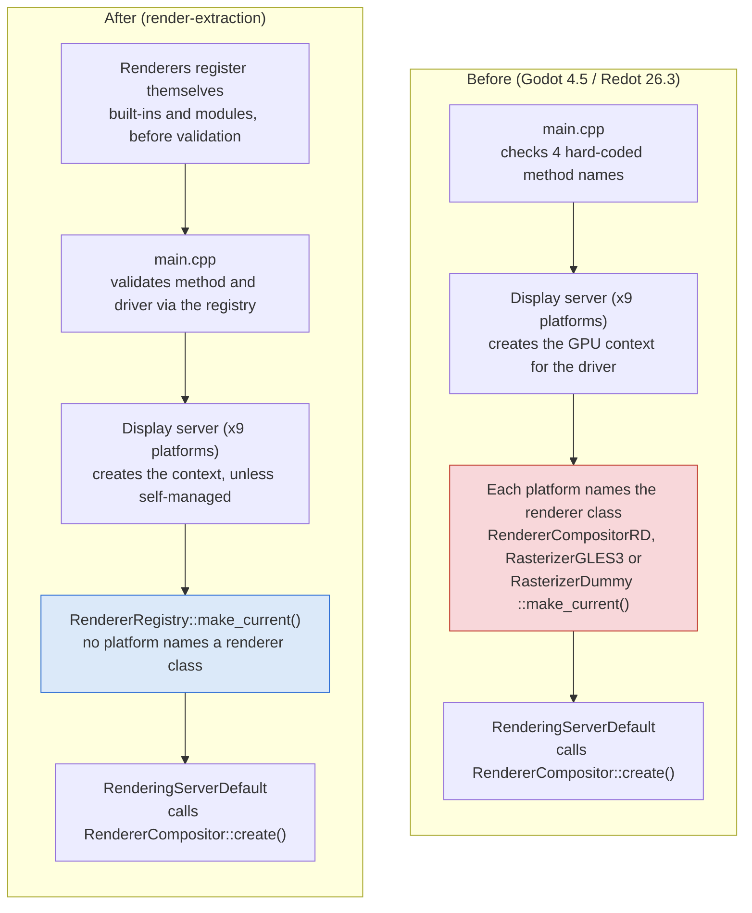

# Swappable Renderers in Redot: How We Extracted the Render Engine

Oct 24, 2026 · William

> Exported from the team doc. The living version is the shared doc; this copy is kept next to the code.

## Summary

Redot can now build, link and run with no built-in renderer at all, and a renderer written outside the engine can be plugged in without editing any platform code. The default build is unchanged: frames are pixel-identical to the unmodified 26.3 build and the public extension API is byte-for-byte identical (1,006 classes).

What was done, on branch `render-extraction` (21 commits, 79 engine files, +1,501 / -237 lines):

- **A renderer registry** replaces the renderer class hard-coded into each of 9 platform display servers. Renderers register a name, the GPU drivers they run on, a create hook and a feature set.
- **Self-managed renderers** can own their entire graphics API (raw Vulkan today, on Linux X11) instead of going through Redot's `RenderingDevice`. A working example renderer ships as a module.
- **Feature flags** replace 33 checks that compared renderer names as strings (`"forward_plus"`, `"gl_compatibility"`), so a new renderer is no longer treated as unknown by the editor and scene code.
- **The built-in renderers are separate libraries** (`librenderer_rd`, `librenderer_gles3`), linked only by one registration file. Two build options (`builtin_renderer_rd`, `builtin_renderer_gles3`) leave them out entirely.

For engineers, the rest of this doc explains how the inherited Godot system works, why pulling the renderer out was so hard, and how each change was verified. For game developers, the step-by-step guide shows how to plug in your own renderer.

Most of the difficulty came from accumulated coupling and hidden dependencies built up over years of feature work, not from any single design decision.

## How the inherited Godot rendering system works

Rendering in Godot 4.5 (and Redot 26.x) is five layers stacked on each other. Engine code talks only to the top one, which is why most of the engine was never the problem.

| Layer | Main types | Where | What it does |
| --- | --- | --- | --- |
| 1. Public API | `RenderingServer` (548 pure-virtual methods) | `servers/rendering/rendering_server.h` | Everything scene, editor and scripts call: create a mesh, set a material, draw a canvas item. All of it is RIDs (opaque handles). |
| 2. Front end | `RenderingServerDefault`, `RendererSceneCull`, `RendererCanvasCull`, `RendererViewport` | `servers/rendering/*.cpp` | Implements the API once for every renderer: command queue (optional render thread), culling, viewport bookkeeping, then calls the backend. |
| 3. Backend interface | `RendererCompositor` plus storage interfaces (`RendererTextureStorage`, `RendererMeshStorage`, ...), `RendererSceneRender`, `RendererCanvasRender` | `servers/rendering/renderer_compositor.h`, `servers/rendering/storage/` | The contract a renderer fills in: ten storage/render subsystems plus frame hooks (`initialize`, `begin_frame`, `blit_render_targets_to_screen`, `end_frame`, `finalize`). |
| 4. Built-in backends | `RendererCompositorRD` (Forward+ and Mobile), `RasterizerGLES3` (Compatibility), `RasterizerDummy` | `servers/rendering/renderer_rd/`, `drivers/gles3/`, `servers/rendering/dummy/` | The actual renderers. About 290,000 lines in `servers/rendering` plus 47,000 for GLES3. |
| 5. GPU abstraction | `RenderingDevice`, `RenderingContextDriver`, per-API drivers | `servers/rendering/rendering_device*`, `drivers/{vulkan,d3d12,metal}` | A Vulkan-like API over Vulkan, D3D12 and Metal. Forward+ and Mobile are built on it; it is also public to scripts and modules. |

The interface between layers 3 and 4 was already the right seam: 2,498 call sites outside the renderer go through `RenderingServer::get_singleton()` and never touch a backend.

### How a renderer was chosen at startup

Two independent settings decide what runs:

- **Rendering driver** = the graphics API and context: `vulkan`, `d3d12`, `metal`, `opengl3`, `opengl3_es`, `opengl3_angle`, `dummy`.
- **Rendering method** = the renderer: `forward_plus`, `mobile`, `gl_compatibility`, `dummy`.

The startup flow was:

1. `main.cpp` reads `--rendering-method` / `--rendering-driver` or the project settings, and checks them against a hard-coded list of four method names and a hard-coded method-to-driver table.
2. `DisplayServer::create()` builds the platform display server (X11, Wayland, Windows, macOS, Android, web, iOS, headless; 9 implementations).
3. Each display server creates the graphics context for the driver (`RenderingContextDriverVulkanX11`, `GLManager_X11`, ...). This part is legitimately platform code.
4. Each display server then **hard-codes the renderer**: `RendererCompositorRD::make_current()`, `RasterizerGLES3::make_current(bool)` or `RasterizerDummy::make_current()`. These only set the static `RendererCompositor::_create_func`.
5. `RenderingServerDefault` calls `RendererCompositor::create()`. Inside `RendererCompositorRD`, the method string picks Forward+ or Mobile.

Step 4 is the core problem: the renderer choice was fused into 9 platform files, so adding a renderer meant editing every platform.

## Why pulling the renderer out was so hard

The renderer is not tangled with the engine in one big knot; it is tied down by many small threads, and most of them are invisible until you cut one. Every time one piece moves, an unrelated file breaks for a reason that doesn't show up in that file.

What we found, measured on the 26.3 tree:

| Coupling | Scale | Effect on extraction |
| --- | --- | --- |
| Renderer hard-coded per platform | 9 display servers, 30 call sites | Adding a renderer meant editing every platform. |
| Renderer chosen by string name | 4 names hard-coded in `main.cpp`; 33 runtime checks in scene, editor and server code (plus editor UI and exporters) | A new renderer is "unknown" everywhere: wrong warnings, rejected at startup. |
| Engine code reaching into renderer internals | 36 includes of backend headers from 22 files outside the backends (XR, OpenXR, WebXR, shader baker, platform code, `register_server_types.cpp`) | Can't build the engine without the backend. |
| Renderer reaching up into higher layers | About 20 includes (`main/main.h`, `scene/...`, XR, camera, display) | Backend can't be a library below the engine. |
| Hidden transitive includes | Found 5 at build time: Wayland got `RenderingServer` only via the dummy renderer header; `register_server_types.cpp` got `BlitToScreen` only via RD headers; OpenXR GL got GL declarations only via GLES3 headers on Windows; and others | Removing one include breaks a file that never mentions the removed type. This is the main reason the work felt impossible. |
| Misplaced build pieces | `spirv-reflect` built from the RD *renderer* folder but used only by `RenderingDevice` | Only shows up as a link error once the renderer is a separate library. |

### What caused the coupling

Every finding was traced with `git blame` and commit history, and each one has an ordinary explanation:

- Includes left behind by large refactors: GL 3.3 rewrite (2021), dummy renderer split (2022), physics interpolation (2024).
- Copy-paste divergence between platforms: Android and iOS leak the `RenderingDevice` on init failure; macOS ignores init failure entirely. Both date to 2020.
- Shortcuts taken when features were added: XR reading RD texture storage directly, with an in-code `@todo` acknowledging it.

The full findings log (15 entries, each with file, line, cost, history and likely cause) is in `render_extraction/FINDINGS.md`. Six of the defects are now standalone bug-fix PRs.

## The new architecture

The five layers are the same; what changed is that layer 4 (the renderers) now plugs into layer 3 through one registry instead of being wired into platforms, `main.cpp`, scene code and the editor.



The GPU context is still created by each platform, because that really is platform code; only the choice of renderer moved into the registry.

### RendererRegistry

`servers/rendering/renderer_registry.h` holds every available renderer. Each one registers a `RendererInfo`:

| Field | Meaning |
| --- | --- |
| `name` | The rendering method name, as used by `--rendering-method` and `rendering/renderer/rendering_method`. |
| `drivers` | Rendering drivers it runs on, e.g. `{"vulkan", "d3d12", "metal"}`. |
| `context_mode` | Who creates the GPU context (below). |
| `features` | Bitmask of `RendererRegistry::Feature` values it supports. |
| `make_current` | Hook that sets up the renderer's create function, given a `ContextInfo` (driver name, desktop-GL vs GLES). |

The registry also carries two extra hooks a renderer can use: `add_class_registration()` for scriptable classes (the RD renderer's `RenderSceneBuffersRD` and friends now register this way) and `add_editor_plugin_registration()` for editor tooling (the RD shader baker now registers this way).

### Context modes: who owns the GPU

| Mode | Who creates the context | Used by |
| --- | --- | --- |
| `CONTEXT_RD` | Display server creates `RenderingContextDriver` + `RenderingDevice` | Forward+, Mobile |
| `CONTEXT_GL` | Display server creates the OpenGL / GLES / ANGLE context | Compatibility |
| `CONTEXT_NONE` | Nobody | Dummy (headless) |
| `CONTEXT_SELF_MANAGED` | **The renderer itself**, from the native window handles | Raw-API renderers, e.g. `modules/raw_vulkan_test` |

With `CONTEXT_SELF_MANAGED`, the display server creates plain windows and no context; the renderer reads `DisplayServer::window_get_native_handle(DISPLAY_HANDLE / WINDOW_HANDLE)` and creates its own `VkInstance`, surface, device and swapchain.

### Startup flow now

1. `register_renderer_types()` registers the built-in renderers, then CORE-level modules run and may register more. This happens before any validation.
2. `main.cpp` validates the method and driver **against the registry**, both when they come from the command line and when they come from project settings. A method this build doesn't have falls back to the first renderer registered for the driver, with an error.
3. The display server creates the context for the driver, unless the renderer is self-managed.
4. The display server calls `RendererRegistry::make_current(context)`; no platform names a renderer class any more.
5. `RenderingServerDefault` creates the renderer as before.

### Feature flags

Scene, editor and server code now asks `RendererRegistry::has_feature(FEATURE_SSR)` instead of `get_current_rendering_method() == "forward_plus"`. There are 23 flags (full list in the reference). The built-in renderers declare exactly the sets the old string checks implied, including the odd ones for the dummy renderer, so headless runs report the same warnings as before.

### Libraries and build options

| Library | Contents | Linked by |
| --- | --- | --- |
| `librenderer_rd` | Forward+, Mobile, their effects, storage, shaders, and the shader baker (editor builds) | `drivers/register_driver_types.cpp` only |
| `librenderer_gles3` | Compatibility renderer | `drivers/register_driver_types.cpp` only |

Both sit right after the `drivers` library in the link order, so any engine code that secretly depends on a renderer fails to **link**. That makes the boundary enforced by the build, not by convention. `builtin_renderer_rd=no` and `builtin_renderer_gles3=no` leave the libraries out while keeping the Vulkan / OpenGL drivers for custom renderers.

The dummy renderer stays part of the renderer API, not a backend: headless mode needs it, and it is the natural base class for a new renderer (it implements every subsystem as a no-op).

## The process, phase by phase

The work ran in five phases, each ending in a verified, committed state, so any step can be reviewed or reverted on its own. The guiding rule: change structure, never behaviour, and prove it after every step.

| Phase | What changed | Key decision and why | Commits |
| --- | --- | --- | --- |
| 0. Map | Scanned every `#include` in both directions; measured layers, call sites and violations; set up a pixel-regression harness | Measure before cutting: the map showed the public API seam was already good and the real knots were about 100 sites | `632717deed`, `3f71f3950c` |
| 1. Registry | Added `RendererRegistry`; all 9 display servers and headless ask it instead of naming a renderer class | Keep phase 1 a pure refactor with identical output, so it is safe to land on its own | `6e3335d191`, `3835e84a21`, `448047c034` |
| 2. Self-managed renderers | `CONTEXT_SELF_MANAGED`; X11 skips context creation for such renderers; `main.cpp` validates against the registry; renderer registration moved before CORE module init; example module `raw_vulkan_test` | Raw API access rather than `RenderingDevice`, because the first custom renderer (Unironic) is a raw Vulkan engine | `79f3503ddc`, `448047c034`, `e12f26e667` |
| 3. Feature flags | 23 flags replace 33 method-name string checks in scene, editor and servers | Warning texts left unchanged so translations stay valid; dummy's flags copy its old behaviour exactly | `458ff2baf2`, `14e87fd725` |
| 4. Extraction | Boundary checker; RD script classes and shader baker register through registry hooks; XR goes through the abstract texture storage; EGL owns its own flag; `librenderer_rd` and `librenderer_gles3` split out; build options to omit them; final method validation | Let the linker enforce the boundary: a separate library placed after `drivers` fails to link if anything else depends on it | `44d74c0178`, `c07d73ee75`, `61d40addd3`, `be9ddde00f`, `c969313649` |

Along the way, defects unrelated to extraction were fixed on separate branches as bug-fix PRs (see Status) rather than mixed into the refactor.

### Mistakes made and caught

Skeptical reviewers should know where the process itself went wrong, and how it was caught:

- **A regression in phase 1.** A project whose `project.godot` names an unknown renderer (a typo) used to fall back to Forward+. After the registry change it failed instead. The no-built-in-renderers build exposed it; it is fixed in `c969313649` and verified against the original build.
- **Code that wouldn't compile on platforms we can't build.** A web call site used a variable that only exists on other platforms, and an Android include landed inside the wrong `#if`. Both were caught by reviewing every call site by hand before commit.
- **Windows header macros.** Mixing editor and GL headers in one file broke the Windows build (`windows.h` defines `IGNORE`). Caught by the MinGW cross-build; fixed by moving the RD editor registration into its own file.
- **Hidden includes.** Each removal of a backend include was followed by a full build; five files turned out to depend on types they never included directly.

## Verification: how we know nothing changed

Every check compares the modified build against the unmodified 26.3 build on the same machine (Linux, AMD RX 6800 XT, Mesa RADV), and every one of them was identical on the final state.

| Check | What it proves | Result |
| --- | --- | --- |
| Pixel regression | A 3D + 2D scene rendered with Forward+, Mobile, Compatibility (opengl3) and Compatibility (opengl3_es), frames compared with ImageMagick | 0 differing pixels in all four |
| Feature-flag probe | A script triggers every renderer-feature check reachable from GDScript (environment effects, DoF, auto-exposure, 4 scaling modes, SSAA, TAA, shader hint, visual-shader code generation) and records every warning and error | Output identical for forward_plus, mobile, gl_compatibility, dummy and headless (38 warning/error lines) |
| Editor-only checks | An editor plugin records which Environment glow properties are shown per renderer | Identical (2 hidden on Forward+/Mobile, 26 on Compatibility) |
| Public API | `--dump-extension-api` from both builds | Identical apart from the version header; 1,006 classes |
| Shader baker | `.pck` export with `shader_baker/enabled` | Same 345 bake steps (exports aren't byte-deterministic even with the same binary) |
| No built-in renderers | Build with `builtin_renderer_rd=no builtin_renderer_gles3=no` | Builds and links; runs headless and with `raw_vulkan_test`; renderer strings absent from the binary |
| Raw Vulkan renderer | Khronos validation layer with best practices and synchronization validation, plus a live window resize | No errors or warnings; one informational "swapchain suboptimal" on resize, which the renderer handles |
| Windows | MinGW cross-build of every step | Builds and links; not run on Windows |

### Rerunning the checks

The tools are committed under `render_extraction/`:

```sh
cd render_extraction/regression
# Pixel regression: render each renderer/driver combination, then compare frame 5
./rtest.sh /path/to/old/redot.linuxbsd.editor.x86_64 /tmp/out_old
./rtest.sh ../../bin/redot.linuxbsd.editor.x86_64 /tmp/out_new
for c in forward_plus_vulkan mobile_vulkan gl_compatibility_opengl3 gl_compatibility_opengl3_es; do
  compare -metric AE /tmp/out_old/${c}00000005.png /tmp/out_new/${c}00000005.png null:; echo " $c"
done

# Feature-flag probe
./flagtest.sh /path/to/old/binary /tmp/flag_old
./flagtest.sh ../../bin/redot.linuxbsd.editor.x86_64 /tmp/flag_new
for m in forward_plus mobile gl_compatibility dummy headless; do diff -q /tmp/flag_old/$m.txt /tmp/flag_new/$m.txt; done

# Boundary: engine code including renderer internals (exit code 1 if any)
python3 ../tools/check_renderer_boundary.py ../..
```

The boundary checker currently reports 13 violations, all in macOS, iOS, Android and web files that could not be compiled on the Linux machine used for this work.

## Guide: plug in your own renderer

A custom renderer is an ordinary Redot module that registers itself with `RendererRegistry`; no engine file needs editing. The working reference is `modules/raw_vulkan_test/` (about 350 lines): it creates its own Vulkan instance, surface, device and swapchain from Redot's window and clears the screen to an animated colour. Copy it and grow it.

Current support: Linux, X11 session, raw Vulkan. See Status for other platforms.

### 1. Create the module

```
modules/my_renderer/
  config.py          # when the module can be built
  SCsub              # sources + Vulkan headers/loader
  register_types.h
  register_types.cpp # registers the renderer
  my_renderer.h      # your RendererCompositor
  my_renderer.cpp
```

`config.py`:

```python
def can_build(env, platform):
    return platform == "linuxbsd" and env["vulkan"] and env["x11"]


def configure(env):
    pass
```

(The example also has `is_enabled()` returning `False`, so it only builds when asked for. Leave that out if you want yours on by default.)

`SCsub`: your sources need the same Vulkan headers, `volk` loader and platform define the engine's Vulkan driver uses:

```python
Import("env")
Import("env_modules")

env_my = env_modules.Clone()
env_my.Prepend(CPPPATH=["#thirdparty/vulkan", "#thirdparty/vulkan/include"])
if env["use_volk"]:
    env_my.AppendUnique(CPPDEFINES=["USE_VOLK"])
    env_my.Prepend(CPPPATH=["#thirdparty/volk"])
env_my.AppendUnique(CPPDEFINES=["VK_USE_PLATFORM_XLIB_KHR"])

env_my.add_source_files(env.modules_sources, "*.cpp")
```

### 2. Register at the CORE level

Renderers must be registered before `main.cpp` checks `--rendering-method`, which happens before the other module levels run. Register at `MODULE_INITIALIZATION_LEVEL_CORE`:

```cpp
#include "register_types.h"

#include "my_renderer.h"

#include "servers/rendering/renderer_registry.h"

static void _make_current_my_renderer(const RendererRegistry::ContextInfo &p_context) {
	MyRenderer::make_current();
}

void initialize_my_renderer_module(ModuleInitializationLevel p_level) {
	if (p_level != MODULE_INITIALIZATION_LEVEL_CORE) {
		return;
	}
	RendererRegistry::RendererInfo info;
	info.name = "my_renderer"; // --rendering-method my_renderer
	info.drivers.push_back("vulkan"); // --rendering-driver vulkan
	info.context_mode = RendererRegistry::CONTEXT_SELF_MANAGED;
	info.features = 0; // Add RendererRegistry::FEATURE_* bits as you implement them.
	info.make_current = _make_current_my_renderer;
	RendererRegistry::register_renderer(info);
}

void uninitialize_my_renderer_module(ModuleInitializationLevel p_level) {
}
```

### 3. Start from the dummy renderer

Subclass `RasterizerDummy`. Every subsystem (textures, meshes, materials, canvas, scene, lights, particles, GI, fog) then exists as a do-nothing implementation, so the whole engine runs while you write only the frame code:

```cpp
#include "drivers/vulkan/godot_vulkan.h" // volk or vulkan.h, as the engine uses
#include "servers/rendering/dummy/rasterizer_dummy.h"

class MyRenderer : public RasterizerDummy {
	VkInstance instance = VK_NULL_HANDLE;
	VkSurfaceKHR surface = VK_NULL_HANDLE;
	// device, queue, swapchain, sync objects ...

public:
	void initialize() override; // create instance, surface, device, swapchain
	void end_frame(bool p_present) override; // record, submit, present
	void finalize() override; // destroy everything

	static RendererCompositor *_create_current() { return memnew(MyRenderer); }
	static void make_current() {
		_create_func = _create_current;
		low_end = false;
	}
};
```

### 4. Get the window from Redot

Redot owns the window; don't create one (no GLFW). When your renderer is created, the main window already exists. Build the surface from its native handles, where a GLFW engine would call `glfwCreateWindowSurface`:

```cpp
#ifdef USE_VOLK
	volkInitialize(); // before vkCreateInstance
#endif
	// ... vkCreateInstance with VK_KHR_surface + VK_KHR_xlib_surface ...
#ifdef USE_VOLK
	volkLoadInstance(instance);
#endif

	DisplayServer *ds = DisplayServer::get_singleton();
	VkXlibSurfaceCreateInfoKHR info = {};
	info.sType = VK_STRUCTURE_TYPE_XLIB_SURFACE_CREATE_INFO_KHR;
	info.dpy = (Display *)ds->window_get_native_handle(DisplayServer::DISPLAY_HANDLE);
	info.window = (::Window)ds->window_get_native_handle(DisplayServer::WINDOW_HANDLE);
	vkCreateXlibSurfaceKHR(instance, &info, nullptr, &surface);

	// ... pick device, vkCreateDevice, then volkLoadDevice(device) ...
```

### 5. Draw and present in end_frame()

Redot runs the main loop. Your `drawFrame()` lives in `end_frame(bool p_present)`:

- Draw only when `p_present` is true.
- Present yourself with `vkQueuePresentKHR`. Do **not** call `DisplayServer::swap_buffers()` the way the dummy renderer does.
- Recreate the swapchain when the surface extent changes: check `vkGetPhysicalDeviceSurfaceCapabilitiesKHR` each frame, and handle `VK_ERROR_OUT_OF_DATE_KHR` / `VK_SUBOPTIMAL_KHR`. Skip the frame while the window is minimized (extent 0).
- `get_total_time()` and `get_frame_delta_time()` from the base class give you timing.

If you're coming from a typical Vulkan tutorial engine (window → device → swapchain → pipeline → app loop), the mapping is: window = Redot's; device and swapchain = yours, created in `initialize()`; the app's draw function = `end_frame()`.

### 6. Build and run

```sh
scons platform=linuxbsd target=editor module_my_renderer_enabled=yes -j$(nproc)
./bin/redot.linuxbsd.editor.x86_64 --path /path/to/project \
    --rendering-method my_renderer --rendering-driver vulkan
```

To test against nothing but your renderer, add `builtin_renderer_rd=no builtin_renderer_gles3=no` to the scons line (and `extra_suffix=myonly` to keep it apart from your normal build). A project that asks for `forward_plus` then falls back to your renderer with an error message.

Run with the validation layer while developing:

```sh
VK_INSTANCE_LAYERS=VK_LAYER_KHRONOS_validation VK_LAYER_VALIDATE_SYNC=true \
  ./bin/redot.linuxbsd.editor.x86_64 --path /path/to/project --rendering-method my_renderer --rendering-driver vulkan
```

### 7. Replace subsystems one at a time

To see what the engine draws, override the dummy subsystems' getters with your own implementations, in roughly this order:

| Order | Getter | What it covers |
| --- | --- | --- |
| 1 | `get_texture_storage()` | Textures, render targets, viewport output. Needed before anything the engine draws can reach the screen. |
| 2 | `get_canvas()` | 2D: UI, sprites. Gets the editor UI on screen. |
| 3 | `get_mesh_storage()`, `get_material_storage()` | Vertex/index buffers, shaders, materials. |
| 4 | `get_scene()` | 3D: cameras, lights, environment. |
| 5 | `get_light_storage()`, `get_particles_storage()`, `get_gi()`, `get_fog()`, `get_utilities()` | The rest, as needed. |

The frame hooks are `initialize()`, `begin_frame(step)`, `blit_render_targets_to_screen(...)`, `end_frame(present)` and `finalize()`.

### 8. Declare features as you build them

Set `info.features` bits as features become real. Scene and editor code checks them, so users get "not available" warnings for anything you haven't built yet instead of silent no-ops. Start at `0`.

### Troubleshooting

| Symptom | Cause |
| --- | --- |
| "Unknown rendering method 'my_renderer'" | The module isn't built (`module_my_renderer_enabled=yes`) or registers at a level later than CORE. |
| "Invalid renderer/driver combination" | The `--rendering-driver` isn't in `info.drivers`. |
| Black window, no errors | `end_frame()` isn't presenting, or `p_present` is false. |
| Validation errors on resize | Swapchain not recreated when the extent changes. |
| `--write-movie` or viewport screenshots are blank | They read back through texture storage; implement it first. |

## Reference

### RendererRegistry API

All static, in `servers/rendering/renderer_registry.h`.

| Function | Use |
| --- | --- |
| `register_renderer(const RendererInfo &)` | Add a renderer. Name must be unique and `make_current` set. |
| `find(name)` | The renderer's info, or `nullptr`. |
| `get_renderer_names()` | All registered method names, in registration order. |
| `get_renderers_for_driver(driver)` | Method names that run on a driver. |
| `make_current(context)` | Make the renderer for the current rendering method current. The `dummy` driver always selects `dummy`. Called by display servers. |
| `make_current(name, context)` | Make a specific renderer current (e.g. a fallback to `dummy`). |
| `get_current()` | The renderer made current, or `nullptr`. |
| `has_feature(Feature)` | Whether the renderer for the current rendering method supports a feature. |
| `get_current_context_mode()` | Context mode of the current rendering method's renderer (`CONTEXT_NONE` if unknown). |
| `add_class_registration(func)` | Register scriptable classes; called from `register_server_types()` after the server base classes exist. |
| `add_editor_plugin_registration(func)` | Register editor tooling; called by the editor when its export system exists. |

`RendererInfo`: `name`, `drivers`, `context_mode`, `features`, `make_current`. `ContextInfo`: `driver`, `gles_over_gl` (desktop GL vs GLES, `CONTEXT_GL` only).

### Feature flags

| Flag | Forward+ | Mobile | Compatibility | Dummy |
| --- | --- | --- | --- | --- |
| `FEATURE_GEOMETRY_TRANSPARENCY` | yes | | | |
| `FEATURE_VISIBILITY_RANGE_FADE` | yes | | | |
| `FEATURE_LIGHT_PROJECTORS` | yes | yes | | |
| `FEATURE_PARTICLE_TRAILS` | yes | yes | | |
| `FEATURE_PARTICLE_SUB_EMITTERS` | yes | yes | | |
| `FEATURE_VOLUMETRIC_FOG` | yes | | | |
| `FEATURE_VOXEL_GI` | yes | yes | | |
| `FEATURE_DECALS` | yes | yes | | |
| `FEATURE_DOF_BLUR` | yes | yes | | yes |
| `FEATURE_AUTO_EXPOSURE` | yes | | | yes |
| `FEATURE_SSR` | yes | | | |
| `FEATURE_SSAO` | yes | | | |
| `FEATURE_SSIL` | yes | | | |
| `FEATURE_SDFGI` | yes | | | |
| `FEATURE_GLOW_FULL` (levels, blend modes, strength, mix) | yes | yes | | yes |
| `FEATURE_DEBUG_DRAW_MODES` (editor, RD scene buffers) | yes | yes | | yes |
| `FEATURE_DEBUG_DRAW_MODES_CLUSTERED` (editor, Forward+ buffers) | yes | | | yes |
| `FEATURE_SCALING_3D_ADVANCED` (non-bilinear, MetalFX Spatial) | yes | yes | | yes |
| `FEATURE_SCALING_3D_FSR` (FSR 1, FSR 2, MetalFX Temporal) | yes | | | |
| `FEATURE_SCREEN_SPACE_AA` | yes | yes | | yes |
| `FEATURE_TAA` | yes | | | |
| `FEATURE_NORMAL_ROUGHNESS_BUFFER` (`hint_normal_roughness_texture`) | yes | | | |
| `FEATURE_SHADER_DESKTOP_BUILTINS` (`fma()`, coarse/fine derivatives) | yes | yes | | yes |

Dummy's set looks odd because it reproduces exactly how the old string checks treated it; changing it would change warnings and errors in headless and CI runs.

### Build options

| Option | Default | Effect |
| --- | --- | --- |
| `builtin_renderer_rd` | `yes` | Build `librenderer_rd` and register Forward+ / Mobile, their script classes and the shader baker. |
| `builtin_renderer_gles3` | `yes` | Build `librenderer_gles3` and register Compatibility (needs `opengl3=yes`). |
| `vulkan`, `opengl3`, `d3d12`, `metal` | unchanged | GPU drivers; independent of the options above. |
| `module_raw_vulkan_test_enabled` | `no` | Build the example self-managed renderer. |

### Command line

| Flag | Use |
| --- | --- |
| `--rendering-method <name>` | Any registered renderer. An unknown name lists the valid ones. |
| `--rendering-driver <driver>` | Must be in the renderer's `drivers`. |
| `--headless` | Always the dummy renderer, whatever the project asks for. |

## Status, limitations and open work

Linux is done and verified; Windows compiles and links but has not been run; macOS, iOS, Android and web are converted by hand review only and have not been compiled.

### Limitations today

- **Self-managed renderers work on X11 only.** Wayland and Windows need the same small change X11 got (skip context creation, make the renderer current once the main window exists).
- **One window.** A self-managed renderer builds a surface for the main window only; editor sub-windows would need per-window surfaces.
- **`RenderingDevice` features are unavailable to self-managed renderers:** the RD lightmapper, GPU texture compression (betsy), the `RenderingDevice` scripting API, the OpenXR Vulkan path, and the shader baker.
- **Warning texts still name the built-in renderers** ("only available when using the Forward+ renderer"). The *condition* uses feature flags; the *wording* was kept to avoid breaking translations.
- **The editor's renderer dropdown** (project settings, project manager, editor build profiles) still lists only the built-in renderers.
- **`RenderingDevice` prints renderer names** in its startup line, and prints "Forward+" for any non-Mobile method, including custom ones. Cosmetic.

### Open work

- [ ] Compile-test macOS, iOS, Android and web, then remove the 13 remaining leftover backend includes the boundary checker reports.
- [ ] Self-managed support on Wayland and Windows.
- [ ] Editor renderer dropdown built from the registry.
- [ ] Run the Windows build on Windows.
- [ ] Decide whether the registry/extraction work itself goes upstream to Redot as a PR series.

### Bug-fix PR batch

Six fixes found along the way are separate branches off `master`, independent of the extraction. Tested together as `test/pr-batch`: Linux and Windows build with no warnings, and every regression check above is identical. Waiting on hand testing; nothing has been pushed.

| # | Branch | Fix | Needs hand test on |
| --- | --- | --- | --- |
| 1 | `fix/unused-renderer-scene-includes` | 3 unused `scene/` includes in the renderer | Any platform |
| 2 | `fix/rd-init-failure-cleanup` | `RenderingDevice` leaked on init failure (Android, iOS); init failure ignored (macOS) | macOS, Android, iOS |
| 3 | `fix/remove-dead-gpu-probe-renderer-calls` | Dead renderer call in the GPU probe subprocess | Linux, Windows |
| 4 | `fix/egl-owns-angle-flipped-y` | EGL context layer no longer reaches into the GL renderer | Windows with `opengl3_angle` |
| 5 | `fix/spirv-reflect-build-location` | spirv-reflect built next to `RenderingDevice`, its only user | Any platform |
| 6 | `fix/xr-render-target-texture-abstract` | XR uses the abstract texture storage instead of RD internals | XR hardware, if available |

## Appendix: where everything is

All work is on branch `render-extraction` in `/mnt/disk2/Redot/render-extraction` (based on `master` at `860c27364f`, Redot 26.4.0-alpha / Godot 4.5.2). The unmodified reference tree is `/mnt/disk2/Redot/26.3`.

| Path | What |
| --- | --- |
| `servers/rendering/renderer_registry.{h,cpp}` | The registry, feature flags, context modes, hooks |
| `drivers/register_driver_types.cpp` | Registers the built-in renderers; the only engine file that names them |
| `servers/rendering/renderer_rd/` | Forward+ / Mobile, built as `librenderer_rd` |
| `servers/rendering/renderer_rd/editor/` | RD shader baker and its registration (moved from `editor/`) |
| `drivers/gles3/` | Compatibility, built as `librenderer_gles3` |
| `servers/rendering/dummy/` | Null renderer: headless, and the base class for new renderers |
| `servers/rendering/spirv-reflect/` | Moved from `renderer_rd/` (used by `RenderingDevice`) |
| `modules/raw_vulkan_test/` | Example self-managed raw Vulkan renderer |
| `platform/*/display_server_*`, `servers/display/display_server_headless.h` | Ask the registry instead of naming renderers; X11 supports self-managed |
| `main/main.cpp` | Registration timing; method/driver validation and fallback via the registry |
| `render_extraction/README.md` | Working notes and status |
| `render_extraction/DEPENDENCY_MAP.md` | The initial coupling map |
| `render_extraction/DESIGN_RENDERER_REGISTRY.md` | Design notes |
| `render_extraction/FINDINGS.md` | 15 findings with file, line, cost and history |
| `render_extraction/WRITING_A_RENDERER.md` | Short in-repo version of the guide above |
| `render_extraction/PR_QUEUE.md` | The bug-fix PR batch with draft descriptions and test steps |
| `render_extraction/regression/` | Pixel test (`rtest.sh`), feature probe (`flagtest.sh`, `flagproj/`) |
| `render_extraction/tools/check_renderer_boundary.py` | Reports engine code that includes renderer internals |
